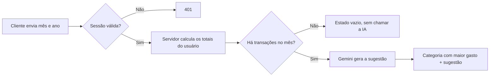

<div align="center">

# FinTrack AI

**Controle financeiro pessoal com dashboard mensal e sugestões de economia geradas por IA.**

[](https://nextjs.org)
[](https://react.dev)
[](https://www.typescriptlang.org)
[](https://tailwindcss.com)
[](https://www.prisma.io)
[](https://fintrack-ai-app-h3zo.vercel.app)

[**Acessar a aplicação**](https://fintrack-ai-app-h3zo.vercel.app) · [Design no Figma](https://www.figma.com/design/QNEXVeiU27cX2V4Ut4i6f0/Fintrack-AI)


</div>

## Sobre o projeto

O FinTrack AI reúne entradas, despesas e investimentos em um único painel. A cada mês, o app mostra o saldo, compara o resultado com o mês anterior, aponta a categoria que mais pesou nos gastos e usa IA para sugerir uma ação prática de economia.

A interface foi construída a partir de um design próprio no Figma, em tema escuro, com layout responsivo e totalmente em português do Brasil.

## Funcionalidades

- **Autenticação:** cadastro e login com e-mail e senha, com rotas protegidas.
- **Dashboard mensal:** saldo, receitas, despesas e seletor de mês.
- **Economia do mês:** variação em relação ao mês anterior.
- **Gráfico de distribuição:** proporção entre ganhos, gastos e investimentos.
- **Insights com IA:** categoria com maior gasto e uma sugestão curta de economia, refeitas ao trocar de mês.
- **Gestão de transações:** criação, edição e exclusão, com 3 tipos, 9 categorias e 7 métodos de pagamento.
- **Layout responsivo:** versões para desktop, tablet e celular.

## Tecnologias

| Área | Ferramentas |
| --- | --- |
| Framework | Next.js 16 (App Router, Server Components, Server Actions), React 19 |
| Linguagem | TypeScript em modo strict |
| Interface | Tailwind CSS 4, shadcn/ui, Radix UI, Recharts |
| Formulários | React Hook Form, Zod |
| Banco de dados | PostgreSQL (Neon), Prisma ORM |
| Autenticação | Better Auth |
| Inteligência artificial | Google Gemini (`@google/genai`) |
| Hospedagem | Vercel |

## Como a análise com IA funciona



Algumas decisões importantes do projeto:

- **Os dados vêm do servidor.** O cliente envia só o mês e o ano. Os valores são calculados a partir da sessão, então não é possível enviar números falsos à IA nem consultar dados de outro usuário.
- **A IA só é usada quando faz diferença.** Meses sem transações não geram chamada, e a categoria com maior gasto é calculada diretamente no servidor.
- **A chave da API fica no servidor.** O navegador nunca tem acesso a ela.
- **Falhas têm mensagem própria.** Chave inválida, limite de uso e sobrecarga do serviço são tratados separadamente, com uma nova tentativa automática em caso de sobrecarga.
- **Requisições antigas são canceladas.** Trocar de mês rapidamente não deixa uma resposta atrasada sobrescrever a análise atual.

## Como rodar localmente

### Pré-requisitos

- Node.js 22 ou superior
- Um banco PostgreSQL (local ou em um serviço como o [Neon](https://neon.tech))
- Uma chave da API do Gemini, disponível no [Google AI Studio](https://aistudio.google.com/apikey)

### Instalação

```bash
git clone https://github.com/jasielrasec18-dev/fintrack-ai-app.git
cd fintrack-ai-app
npm install
cp .env.example .env
```

Preencha o `.env` conforme a tabela abaixo e, em seguida, crie as tabelas e inicie o projeto:

```bash
npx prisma migrate dev
npm run dev
```

A aplicação ficará disponível em [http://localhost:3000](http://localhost:3000).

### Variáveis de ambiente

| Variável | Obrigatória | Descrição |
| --- | :---: | --- |
| `DATABASE_URL` | Sim | Conexão usada pela aplicação. Em produção, use a URL com pooler. |
| `DIRECT_URL` | Sim | Conexão direta usada pelas migrations. Sem pooler, pode ser igual à `DATABASE_URL`. |
| `BETTER_AUTH_SECRET` | Sim | Segredo das sessões. Gere com `openssl rand -base64 32`. |
| `BETTER_AUTH_URL` | Sim | URL pública da aplicação, sem barra no final. |
| `GEMINI_API_KEY` | Sim | Chave da API do Gemini. |
| `GEMINI_MODEL` | Não | Modelo usado nos insights. O padrão é `gemini-3.8-flash`. |

### Scripts

| Comando | Descrição |
| --- | --- |
| `npm run dev` | Inicia o ambiente de desenvolvimento |
| `npm run build` | Gera o Prisma Client e o build de produção |
| `npm run start` | Executa o build de produção |
| `npm run lint` | Verifica o código com o ESLint |
| `npx tsc --noEmit` | Faz a checagem de tipos |

## Estrutura do projeto

```text
prisma/                 Schema e migrations do banco
src/
├── app/
│   ├── (auth)/         Telas de login e cadastro
│   ├── _actions/       Server Actions das transações
│   ├── _components/    Componentes da interface
│   ├── _constants/     Rótulos, categorias e meses
│   ├── _data/          Consultas e cálculos do dashboard
│   ├── _schemas/       Validações com Zod
│   ├── api/            Rotas de autenticação e insights
│   └── transactions/   Página de transações
├── lib/                Autenticação, Prisma e utilitários
├── styles/             Estilos globais e tokens de design
└── proxy.ts            Proteção de rotas
```

## Deploy na Vercel

1. Importe o repositório na Vercel e mantenha as configurações detectadas para Next.js.
2. Crie um banco PostgreSQL e obtenha as URLs com pooler e direta.
3. Cadastre as variáveis de ambiente em **Production** e **Preview**. Em uma `DATABASE_URL` com pooler, inclua `pgbouncer=true&connection_limit=1`.
4. Faça o deploy. O script `vercel-build` gera o Prisma Client, aplica as migrations e cria o build.
5. Confirme que `BETTER_AUTH_URL` é igual ao domínio final. Se precisar alterá-la, faça um novo deploy.

## Próximos passos

- [ ] Conta de demonstração com dados de exemplo
- [ ] Sugestão automática de categoria ao digitar o título
- [ ] Cache dos insights no banco
- [ ] Busca, filtros e paginação de transações
- [ ] Gráfico de evolução mensal e gastos por categoria
- [ ] Orçamento por categoria
- [ ] Testes automatizados e integração contínua

## Autor

Desenvolvido por **Jasiel Rasec** · [GitHub](https://github.com/jasielrasec18-dev)
