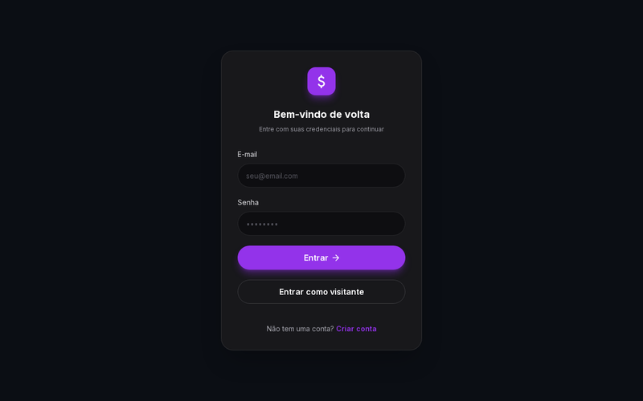
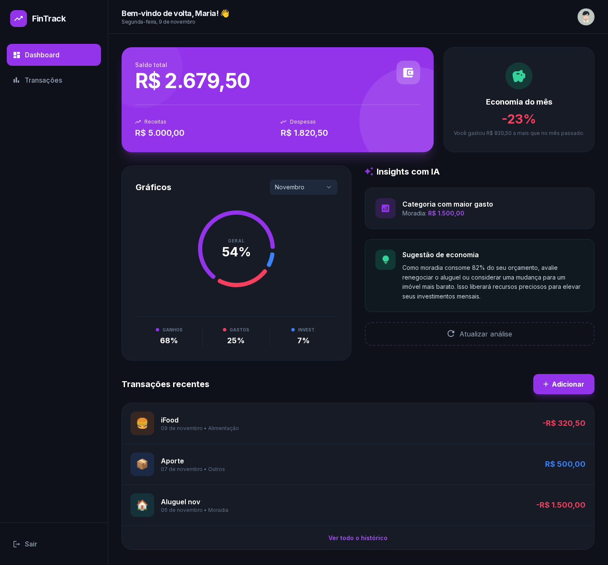
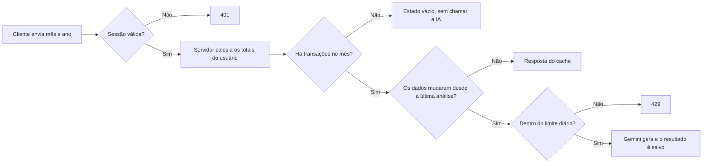

<div align="center">

# FinTrack AI

**Controle financeiro pessoal com dashboard mensal, orçamentos e sugestões de economia geradas por IA.**

[](https://github.com/jasielrasec18-dev/fintrack-ai-app/actions/workflows/ci.yml)

[](https://nextjs.org)
[](https://react.dev)
[](https://www.typescriptlang.org)
[](https://tailwindcss.com)
[](https://www.prisma.io)
[](https://fintrack-ai-app-h3zo.vercel.app)

[**Acessar a aplicação**](https://fintrack-ai-app-h3zo.vercel.app) · [Design no Figma](https://www.figma.com/design/QNEXVeiU27cX2V4Ut4i6f0/Fintrack-AI)

Para conhecer sem criar conta, use **Entrar como visitante** na tela de login.



</div>

## Sobre o projeto

O FinTrack AI reúne entradas, despesas e investimentos em um único painel. A cada mês, o app mostra o saldo, compara o resultado com o mês anterior, acompanha os limites de cada categoria e usa IA para sugerir uma ação prática de economia.

A interface foi construída a partir de um design próprio no Figma, em tema escuro, com layout responsivo e totalmente em português do Brasil.



## Funcionalidades

**Dashboard**

- Saldo, receitas, despesas e variação em relação ao mês anterior
- Gráfico de distribuição e evolução dos últimos 6 meses
- Gastos por categoria e acompanhamento de orçamentos, com alertas visuais

**Transações**

- Criação, edição e exclusão, com máscara de moeda e confirmação
- Busca, filtros por tipo, categoria e período, e paginação sincronizados com a URL
- Tabela no desktop e lista de cards no celular

**Inteligência artificial**

- Sugestão de economia baseada nos dados do mês e nos orçamentos
- Sugestão automática de categoria ao digitar o título da transação

**Experiência**

- Conta de demonstração com 3 meses de dados, reiniciada todos os dias
- Telas de carregamento e de erro, notificações e atalho `N` para nova transação
- Foco visível, contraste revisado e rótulos para leitores de tela

## Tecnologias

| Área | Ferramentas |
| --- | --- |
| Framework | Next.js 16 (App Router, Server Components, Server Actions), React 19 |
| Linguagem | TypeScript em modo strict |
| Interface | Tailwind CSS 4, shadcn/ui, Radix UI, Recharts, Sonner |
| Formulários | React Hook Form, Zod |
| Banco de dados | PostgreSQL (Neon), Prisma ORM |
| Autenticação | Better Auth |
| Inteligência artificial | Google Gemini (`@google/genai`) |
| Testes e CI | Vitest, Playwright, GitHub Actions |
| Hospedagem | Vercel, incluindo Cron Jobs |

## Como a análise com IA funciona



Algumas decisões importantes do projeto:

- **Os dados vêm do servidor.** O cliente envia só o mês e o ano. Os valores são calculados a partir da sessão, então não é possível enviar números falsos à IA nem consultar dados de outro usuário.
- **A IA só é usada quando faz diferença.** Meses sem transações não geram chamada, títulos conhecidos são categorizados por um dicionário local e a análise fica em cache até os dados mudarem.
- **O uso é limitado por usuário.** São até 10 análises e 100 categorizações com IA por dia.
- **A chave da API fica no servidor.** O navegador nunca tem acesso a ela.
- **Falhas têm mensagem própria.** Chave inválida, limite de uso e sobrecarga do serviço são tratados separadamente, com uma nova tentativa automática em caso de sobrecarga.
- **O dashboard faz poucas consultas.** Uma única consulta agrupada alimenta os totais, o mês anterior, as categorias e a evolução.

## Como rodar localmente

### Pré-requisitos

- Node.js 22 ou superior
- Um banco PostgreSQL (local ou em um serviço como o [Neon](https://neon.tech))
- Uma chave da API do Gemini, disponível no [Google AI Studio](https://aistudio.google.com/apikey)

### Instalação

```bash
git clone https://github.com/jasielrasec18-dev/fintrack-ai-app.git
cd fintrack-ai-app
npm install
cp .env.example .env
```

Preencha o `.env` conforme a tabela abaixo. Em seguida, crie as tabelas, gere a conta de demonstração e inicie o projeto:

```bash
npx prisma migrate dev
npx prisma db seed
npm run dev
```

A aplicação ficará disponível em [http://localhost:3000](http://localhost:3000).

### Variáveis de ambiente

| Variável | Obrigatória | Descrição |
| --- | :---: | --- |
| `DATABASE_URL` | Sim | Conexão usada pela aplicação. Em produção, use a URL com pooler. |
| `DIRECT_URL` | Sim | Conexão direta usada pelas migrations. Sem pooler, pode ser igual à `DATABASE_URL`. |
| `BETTER_AUTH_SECRET` | Sim | Segredo das sessões. Gere com `openssl rand -base64 32`. |
| `BETTER_AUTH_URL` | Sim | URL pública da aplicação, sem barra no final. |
| `GEMINI_API_KEY` | Sim | Chave da API do Gemini. |
| `GEMINI_MODEL` | Não | Modelo usado pela IA. O padrão é `gemini-3.8-flash`. |
| `NEXT_PUBLIC_DEMO_EMAIL` | Não | E-mail da conta de demonstração. Sem ele, o botão de visitante não aparece. |
| `NEXT_PUBLIC_DEMO_PASSWORD` | Não | Senha da conta de demonstração, pública por design. |
| `CRON_SECRET` | Não | Protege a rota que reinicia a conta de demonstração. |

### Scripts

| Comando | Descrição |
| --- | --- |
| `npm run dev` | Inicia o ambiente de desenvolvimento |
| `npm run build` | Gera o Prisma Client e o build de produção |
| `npm run start` | Executa o build de produção |
| `npm run lint` | Verifica o código com o ESLint |
| `npm run typecheck` | Faz a checagem de tipos |
| `npm test` | Roda os testes unitários |
| `npm run test:coverage` | Roda os testes unitários com cobertura |
| `npm run test:e2e` | Roda os testes de ponta a ponta |
| `npx prisma db seed` | Cria ou reinicia a conta de demonstração |

## Testes

- **Unitários (Vitest):** cálculos financeiros, períodos, formatação de moeda e dicionário de categorias.
- **Ponta a ponta (Playwright):** login como visitante, sugestão de categoria, criação, busca e exclusão de transações e orçamentos. As rotas de IA são simuladas, então os testes nunca chamam o Gemini.
- **Integração contínua:** a cada push e pull request, o GitHub Actions roda lint, tipos, testes unitários e os testes de ponta a ponta com um PostgreSQL dedicado.

Os testes de ponta a ponta precisam de banco com a conta demo e de um build:

```bash
npx prisma db seed
npm run build
npx playwright install chromium
npm run test:e2e
```

## Estrutura do projeto

```text
.github/workflows/      Integração contínua
e2e/                    Testes de ponta a ponta
prisma/                 Schema, migrations e seed
src/
├── app/
│   ├── (auth)/         Telas de login e cadastro
│   ├── _actions/       Server Actions
│   ├── _components/    Componentes da interface
│   ├── _constants/     Rótulos, categorias e palavras-chave
│   ├── _data/          Consultas do dashboard
│   ├── _schemas/       Validações com Zod
│   ├── api/            Autenticação, IA e rotina diária
│   ├── budgets/        Página de orçamentos
│   └── transactions/   Página de transações
├── lib/                Cálculos, autenticação, IA e utilitários
├── styles/             Estilos globais e tokens de design
└── proxy.ts            Proteção de rotas
```

## Deploy na Vercel

1. Importe o repositório na Vercel e mantenha as configurações detectadas para Next.js.
2. Crie um banco PostgreSQL e obtenha as URLs com pooler e direta.
3. Cadastre as variáveis de ambiente em **Production** e **Preview**. Em uma `DATABASE_URL` com pooler, inclua `pgbouncer=true&connection_limit=1`.
4. Faça o deploy. O script `vercel-build` gera o Prisma Client, aplica as migrations e cria o build.
5. Confirme que `BETTER_AUTH_URL` é igual ao domínio final. Se precisar alterá-la, faça um novo deploy.
6. Para a conta de demonstração, rode `npx prisma db seed` apontando para o banco de produção. O Cron definido em `vercel.json` a reinicia todos os dias usando o `CRON_SECRET`.

## Próximos passos

- [ ] Importação de extrato em CSV
- [ ] Transações recorrentes
- [ ] Tema claro
- [ ] Chat para perguntar sobre as próprias finanças
- [ ] Instalação como PWA

## Autor

Desenvolvido por **Jasiel Rasec** · [GitHub](https://github.com/jasielrasec18-dev)
